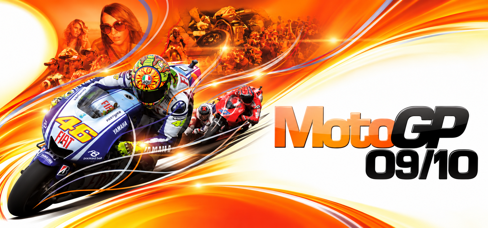
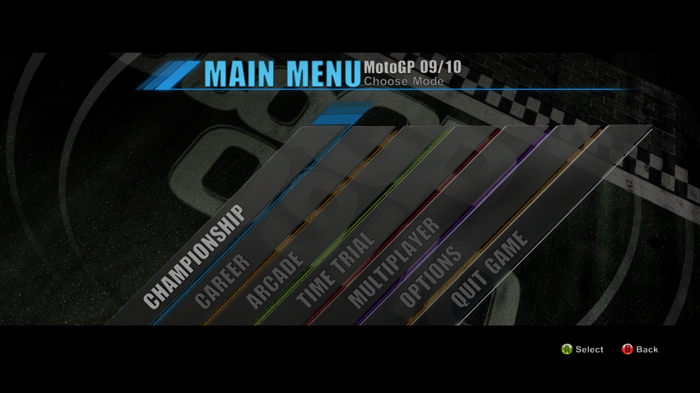
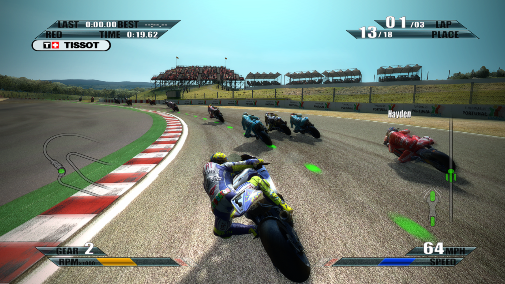
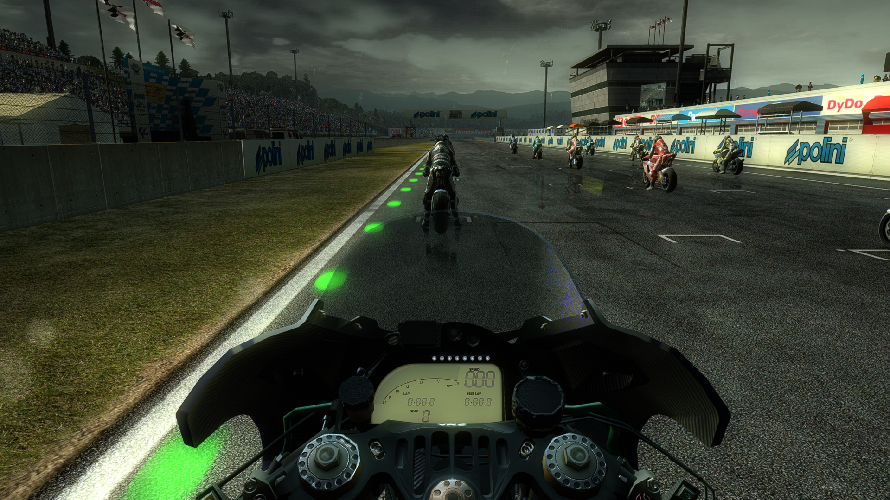
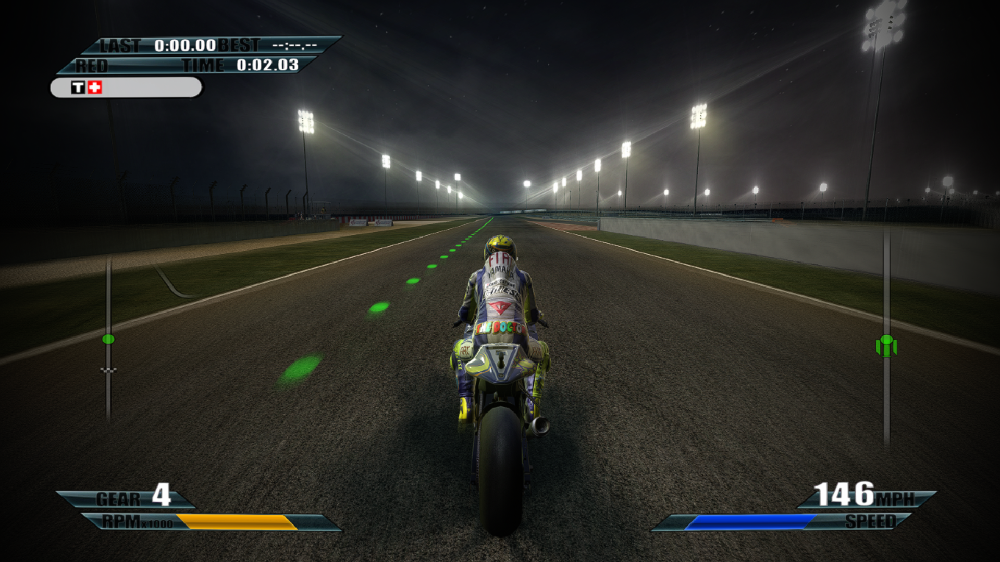

# MotoGP 09/10 PC

Native PC port of MotoGP 09/10, built with [ReXGlue](https://github.com/rexglue/rexglue-sdk).
Community online play is provided by [NOBK Online](https://nobkonline.com/).

## Features

- **Built-in NOBK Online support** — Sign in through the launcher and race online with your NOBK Online account.
- **AMD FSR 1, 2 and 3** — Choose FSR 1, 2 or 3 upscaling, with adjustable sharpness and quality presets for FSR 2/3. AMD CAS sharpening is also available.
- **DualSense adaptive triggers** — Customize fixed L2/R2 resistance, strength and resistance zones on DualSense and DualSense Edge over USB or Bluetooth using SDL input.
- **Button prompt styles** — Choose Xbox, PlayStation or keyboard prompts directly from the launcher.
- **Advanced graphics settings** — Adjust motion blur, depth of field, bloom, vignette, dynamic shadows, shadow filtering, particle density and draw distance directly from the launcher.
- **Native high-resolution rendering** — Play at native 1440p, 4K or 5K, with windowed, fullscreen and borderless display modes.
- **Custom gauge styles** — Switch between MotoGP 06, MotoGP 17, MotoGP URT 2 and MotoGP URT 3 dashboards.
- **Achievements and pop-ups** — View your achievement progress in the launcher or in-game, with on-screen pop-ups when you unlock an achievement.
- **Separate season and class leaderboards** — Chase lap records across 2009 and 2010, with Moto2 and 250cc results kept separate in the game.
- **Friends and invitations** — Invite friends to your lobby and accept or decline invitations from the in-game friends panel.
- **LAN multiplayer** — Race together over a local or virtual network.
- **Split-screen multiplayer** — Race side by side with a friend on one PC.

## Screenshots

  
  

  
  

## Getting started

Requires Windows 10/11 x64, a DirectX 12-capable graphics card and a controller
or keyboard.

**Supply the following content from your own copy of the game; game files, the Title Update and DLC are not included in the package.**

### Required game content

| Item | Supported input | SHA-256 |
| --- | --- | --- |
| Game | MotoGP 09/10, Xbox 360 (USA / Europe) | `54245417e996ed0aa561a5a803fd810e87684bd0b43082f316db711b3ee786ae` |
| Title ID | `434307F0` | — |
| Media ID | `321F4634` | — |
| Title Update | Version `0.0.1.1` | `441df6cc2e20ac8aeeed475138c1714d477f965423d8c5c9b0202e3a18d8141f` |
| DLC | Free GP Class Season 2010 Update | `a1b9e79b369f7fe0440042043839b50e37c9980552ffc856816c413fdecfaf5a` |
| DLC | Free 2010 Moto2 and 125 Update | `2d29e3154c0441f915a3d7d045b75fa605f00d0f12ee333023afb3013a73d60a` |
| DLC | Twin Track Pack | `2044bea000da158ca863568b668544778427d1b91e78f1545063f56103129501` |

The game hash is for the original `default.xex`, not the ISO. The Title Update
hash is for the full update file. DLC hashes refer to the original Xbox 360
package files, not ZIP/RAR/7z archives or extracted folders.

All three DLC packages are required in Offline, LAN and Online modes.

### Setup

1. Extract the complete Windows package into a writable folder. Keep
   `MotoGP09-10Launcher.exe`, `bin/` and `resources/` together; do not run it
   from inside the ZIP.
2. Open `MotoGP09-10Launcher.exe`. On **General**, use **Select ISO** to extract
   your game. For an already extracted copy, use **Browse** to select the folder
   containing `default.xex` and `xenondata/`.
3. Use **Select title update** to import the supported Title Update or its
   verified `default.xexp` patch.
4. Use **Install DLC** to install all three packages from `.zip`, `.rar` or
   `.7z` archives, or extracted folders. Wait for installation to finish.
5. Adjust your settings in the launcher, choose Offline, LAN or Online on the
   **Online** page, then start the game.

**Split-screen setup:** connect two controllers, or connect one controller and
turn on keyboard controls in the launcher.

For a closer look at launcher options and help with setup, see the
[installation guide](docs/INSTALL.md). Launcher updates keep your settings and
remembered sign-in.

## Online on NOBK Online

1. Create an account at [nobkonline.com](https://nobkonline.com/).
   **Your username is your in-game name.**
2. Choose **Online** and sign in on the launcher's **Online** page.
3. Start the game, open **Multiplayer → Online**, choose a race type and
   continue to the lobby.

Host an open lobby, then use **F1 → Friends** to invite someone. Open the
friends panel to accept or decline incoming invitations.

## In-game controls

| Shortcut | Action |
| --- | --- |
| F1 / hold Back (Xbox) or Select (PlayStation) | NOBK Online friends panel |
| F2 | Live settings; pause the race first if needed |
| F7 | Achievements in Offline/LAN; Online uses the F1 panel |

## Files and troubleshooting

| Data | Default location |
| --- | --- |
| Launcher settings | `config.json` beside the launcher |
| Saved game data | `MotoGP 09-10/` in the Windows Documents folder |
| Remembered sign-in | `%LOCALAPPDATA%\MotoGP0910\Online\nobk-account.bin` |

Explicitly configured paths can differ. Remembered sign-in data is encrypted
for the Windows user; the password is not stored. **Sign out** clears it.
Back up saved game data before replacing an installation.

If the game will not start or files may be damaged, use **General → Verify game
files**. This optional check does not repair or download files and is not part
of normal setup. For a missing program file or DLL, extract the complete PC
package again. Use the supported game content in the table above for an
unsupported game/update error.

**Open logs** opens local diagnostics. **Error report** creates a local report
without uploading it; review personal paths and account details before sharing.

## Development

| Guide | Contents |
| --- | --- |
| [Installation](docs/INSTALL.md) | Setup, launcher options and troubleshooting |
| [Building](BUILDING.md) | Windows toolchain, pinned SDK/runtime, packaging and contribution notes |

## Credits

- Monumental Games and Capcom for the original MotoGP 09/10.
- [ReXGlue SDK](https://github.com/rexglue/rexglue-sdk) and [Xenia](https://github.com/xenia-project/xenia), which made the recompilation possible.
- NOBK Online for the community service, and [ChunchunQ](https://github.com/ChunchunQ) for Online integration.
- The dependency authors listed in [third-party notices](resources/launcher/third-party-notices.txt).

## Legal

MotoGP 09/10 PC is an unofficial community project, developed and shared free
of charge. It has no affiliation with or endorsement from Capcom, Monumental
Games, Dorna Sports or Microsoft. Game trademarks, names and artwork remain
the property of their respective rights holders.

Original project code is available under the [MIT License](LICENSE).
Third-party components retain their own licenses; game content and artwork
are not covered by the project license.

You must own MotoGP 09/10 and supply the required game content yourself. This
source repository does not include disc images, original Xbox 360 executables,
Title Update or DLC packages, or generated game source files.

**Please keep requests for game files out of GitHub issues.** Rights holders
can use the issue tracker to identify specific content they would like the
maintainers to review.
